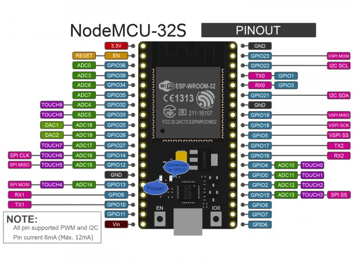

<div align="center">

# 🎮 AngryStation – Mini consolă 3-in-1

**ESP32 · PS5 DualSense prin Bluetooth · TFT 1.8"**


[](LICENSE)

**[🇷🇴 Română](#-română)** · **[🇬🇧 English](#-english)**



<sub>Pinout NodeMCU-32S – sursa: ardushop.ro</sub>

</div>

---

# 🇷🇴 Română

> Proiect PMP (Proiectare cu Microprocesoare), UTCN – CTI, anul 3.

Consolă portabilă inspirată de Nintendo Switch. Rulează **3 jocuri retro** pe un ecran TFT SPI de 1.8" și se controlează cu un controller **PS5 DualSense** prin **Bluetooth**. Ca variantă de rezervă are joystick analogic și butoane fizice.

**Jocuri propuse** (se aleg 3): 🐍 Snake · 🧱 Tetris · 👻 Pac-Man · 🏓 Pong · 🔨 Breakout

## 📦 Componente

| Componentă | Rol |
|---|---|
| NodeMCU-32S (ESP32-WROOM-32, 38 pini) | microcontroller, Bluetooth Classic pentru DualSense |
| Modul LCD SPI 128×160 (ST7735) cu slot SD | afișaj |
| Controller PS5 DualSense | control principal (Bluetooth) |
| Modul joystick analogic XY cu buton | control de rezervă |
| Butoane push (6 mm) | A / B / X / Y / Pause-Home |
| Modul buzzer pasiv 3.3–5 V | sunete |
| LED RGB catod comun 5 mm | indicator „SYNC" / stare |
| Rezistori 1/4 W | LED RGB |
| Breadboard MB-102 (830 puncte) | prototip |
| Fire Dupont (M-M, M-F, F-F) | conexiuni |
| Powerbank + cablu micro-USB | alimentare la demonstrație |

## 🚦 Progres

| Etapă | Descriere | Stare |
|:---:|---|:---:|
| 1 | Setup ESP32: driver CP2102, Arduino IDE, board packages, blink pe GPIO2 | ✅ |
| 1b | Display ST7735 pe breadboard: culori, text, minge pong | ✅ |
| 2 | Controller PS5 prin Bluepad32: pătrat mișcat cu stick-ul, culoare, vibrație | ✅ |
| 3 | Framebuffer (fără pâlpâire) + primul joc complet: Pong | ⏳ |
| 4 | Butoane fizice + joystick ca variantă de rezervă | ⬜ |
| 5 | Meniu de selecție + încă 2 jocuri | ⬜ |
| 6 | Buzzer, LED RGB (indicator SYNC), highscore-uri în flash (`Preferences`) | ⬜ |
| 7 | Carcasă stil Switch; alimentare din powerbank prin micro-USB | ⬜ |

> 💾 Cardul SD **nu este folosit**: pinii modulului SD nu sunt lipiți, iar scorurile se salvează în memoria flash internă (NVS, biblioteca `Preferences`).

## 🔌 Montaj pe breadboard

ESP32 e așezat **cu mufa USB în sus (spre rândul 1)**, pe **rândurile 5–23**, cu pinii în **coloanele b și i**. Rămân libere coloanele **a** (stânga) și **j** (dreapta), câte o gaură pentru fiecare pin.

> ✔️ Verificare: **3V3 = i23**, **GND = b23**. Pe placă pinii sunt marcați `Pxx` (= GPIOxx), `SVP` = GPIO36, `SVN` = GPIO39.

<details>
<summary><b>🗺️ Harta completă a pinilor pe breadboard</b></summary>

| Rând | Stânga (gaura liberă: **a**) | Dreapta (gaura liberă: **j**) |
|:---:|---|---|
| 5 | GPIO6 ⛔ | **Vin (5V)** |
| 6 | GPIO7 ⛔ | GPIO11 ⛔ |
| 7 | GPIO8 ⛔ | GPIO10 ⛔ |
| 8 | GPIO15 | GPIO9 ⛔ |
| 9 | GPIO2 (LED albastru onboard) | GPIO13 |
| 10 | GPIO0 (BOOT) | **GND** |
| 11 | GPIO4 | GPIO12 |
| 12 | GPIO16 | GPIO14 |
| 13 | GPIO17 | GPIO27 |
| 14 | GPIO5 | GPIO26 |
| 15 | GPIO18 | GPIO25 |
| 16 | GPIO19 | GPIO33 |
| 17 | **GND** | GPIO32 |
| 18 | GPIO21 | GPIO35 |
| 19 | RX0 (GPIO3) ⛔ | GPIO34 |
| 20 | TX0 (GPIO1) ⛔ | GPIO39 |
| 21 | GPIO22 | GPIO36 |
| 22 | GPIO23 | EN |
| 23 | **GND** | **3.3V** |

⛔ = nu se folosește (GPIO6–11 sunt legați la flash, GPIO1/3 la serialul USB).

</details>

### ⚡ Alimentare (șina din dreapta)

Pe partea dreaptă a breadboardului, **+ (roșu) e coloana exterioară**, iar **− (albastru) e coloana de lângă j**.

| De la | La |
|---|---|
| j23 (3.3V) | șina **+** dreapta |
| j10 (GND) | șina **−** dreapta |

> ⚠️ Pe șine se pune **doar 3.3V**. Vin (5V) nu se leagă la șina +.
> Componentele se alimentează din zona rândurilor 10–25 (șinele pot fi întrerupte la mijlocul breadboardului).

## 🧷 Conexiuni realizate

### 🖥️ Display ST7735 (128×160, SPI)

| Pin display | Conectat la | GPIO |
|---|---|---|
| VCC | șina + dreapta | 3.3V |
| GND | șina − dreapta | GND |
| CS | a14 | GPIO5 |
| RESET | a13 | GPIO17 |
| A0 (DC) | a12 | GPIO16 |
| SDA (MOSI) | a22 | GPIO23 |
| SCK | a15 | GPIO18 |
| LED (backlight) | șina + dreapta | 3.3V |

```cpp
tft.initR(INITR_BLACKTAB);
tft.setRotation(1);   // 160×128, landscape
```

### 🎮 Controller PS5

Fără fire. Conectare prin Bluetooth Classic (Bluepad32): **Create + PS** până clipește rapid.

| Funcție Bluepad32 | Buton DualSense |
|---|---|
| `a()` | ✖ Cross |
| `b()` | ⭕ Circle |
| `x()` | ⬜ Square |
| `y()` | 🔺 Triangle |
| `axisX()`, `axisY()` | stick stâng (~ −512…512) |
| `dpad()` | `0x01` sus · `0x02` jos · `0x04` dreapta · `0x08` stânga |

## 📝 Conexiuni planificate

| Componentă | GPIO | Gaura | Observații |
|---|---|---|---|
| Joystick VRx | GPIO34 | j19 | ADC1; alimentat la **3.3V** |
| Joystick VRy | GPIO35 | j18 | ADC1 |
| Joystick SW | GPIO32 | j17 | `INPUT_PULLUP` |
| Buton A | GPIO13 | j9 | `INPUT_PULLUP`, buton la GND |
| Buton B | GPIO14 | j12 | `INPUT_PULLUP`, buton la GND |
| Buton X | GPIO27 | j13 | `INPUT_PULLUP`, buton la GND |
| Buton Y | GPIO26 | j14 | `INPUT_PULLUP`, buton la GND |
| Pause / Home | GPIO33 | j16 | `INPUT_PULLUP`, buton la GND |
| Buzzer pasiv | GPIO25 | j15 | PWM (LEDC) |
| LED RGB – R | GPIO21 | a18 | rezistor 220–330 Ω |
| LED RGB – G | GPIO22 | a21 | rezistor 220–330 Ω |
| LED RGB – B | GPIO2 | a9 | rezistor 220–330 Ω (comun cu LED-ul onboard) |
| LED RGB – catod | GND | șina − | |

> 📌 **Reguli:**
> - GPIO34–39 sunt **doar intrări** și nu au pull-up intern, deci nu se folosesc pentru butoane.
> - Pentru semnale analogice se folosește **doar ADC1** (GPIO32–39), pentru că ADC2 nu merge cu Bluetooth activ.
> - GPIO0, 2, 12, 15 sunt pini de strapping, deci se evită pentru butoane.

## 🛠️ Software

| Ce | Versiune / sursă |
|---|---|
| Arduino IDE | 2.x |
| Board package | `esp32_bluepad32` 4.1.0 (include Bluepad32) |
| Board | NodeMCU-32S (esp32_bluepad32) |
| Bibliotecă display | Adafruit ST7735 and ST7789 + Adafruit GFX |
| Salvare scoruri | `Preferences` (inclusă în core) |
| Driver USB | Silicon Labs CP210x Universal Windows Driver |

URL-uri pentru Boards Manager:
```text
https://espressif.github.io/arduino-esp32/package_esp32_index.json
https://raw.githubusercontent.com/ricardoquesada/esp32-arduino-lib-builder/master/bluepad32_files/package_esp32_bluepad32_index.json
```

## 🧯 Depanare

| Simptom | Cauză / soluție |
|---|---|
| Upload blocat la `Connecting...` | se ține apăsat butonul **BOOT (IO0)** |
| Caractere ciudate la reset în Serial Monitor | mesajul de boot la 74880 baud, normal |
| Ecran negru (fără backlight) | nu ajunge 3.3V: se verifică șina și jumătatea de breadboard |
| Ecran alb | display-ul nu e inițializat: se verifică cele 5 fire de semnal |
| Controllerul nu se conectează | consola PS5 trebuie oprită, altfel DualSense se reconectează la ea |

## 📄 Licență

Distribuit sub licența **MIT**. Detalii în [LICENSE](LICENSE).

Proiect educațional, necomercial. PlayStation și DualSense sunt mărci înregistrate ale Sony Interactive Entertainment. Proiectul nu este afiliat cu Sony.

**Autor:** [angryman05](https://github.com/angryman05)

---

# 🇬🇧 English

> DMP (Design with Micro-Processors) project, Technical University of Cluj-Napoca – Computer Science, 3rd year.

A handheld console inspired by the Nintendo Switch. It runs **3 retro games** on a 1.8" SPI TFT screen and is controlled with a **PS5 DualSense** controller over **Bluetooth**. An analog joystick and physical buttons are available as a fallback.

**Candidate games** (3 will be picked): 🐍 Snake · 🧱 Tetris · 👻 Pac-Man · 🏓 Pong · 🔨 Breakout

## 📦 Hardware

| Part | Purpose |
|---|---|
| NodeMCU-32S (ESP32-WROOM-32, 38 pins) | microcontroller, Bluetooth Classic for the DualSense |
| 128×160 SPI LCD module (ST7735) with SD slot | display |
| PS5 DualSense controller | main input (Bluetooth) |
| Analog XY joystick module with button | fallback input |
| 6 mm push buttons | A / B / X / Y / Pause-Home |
| Passive buzzer module, 3.3–5 V | sound |
| 5 mm common-cathode RGB LED | "SYNC" / status indicator |
| 1/4 W resistors | RGB LED |
| MB-102 breadboard (830 points) | prototyping |
| Dupont wires (M-M, M-F, F-F) | connections |
| Power bank + micro-USB cable | power during the demo |

## 🚦 Progress

| Stage | Description | Status |
|:---:|---|:---:|
| 1 | ESP32 setup: CP2102 driver, Arduino IDE, board packages, blink on GPIO2 | ✅ |
| 1b | ST7735 display on the breadboard: colors, text, bouncing ball | ✅ |
| 2 | PS5 controller via Bluepad32: square moved with the stick, color change, rumble | ✅ |
| 3 | Framebuffer (flicker-free) + first complete game: Pong | ⏳ |
| 4 | Physical buttons + joystick as fallback | ⬜ |
| 5 | Game selection menu + 2 more games | ⬜ |
| 6 | Buzzer, RGB LED (SYNC indicator), high scores in flash (`Preferences`) | ⬜ |
| 7 | Switch-style case; powered from a power bank over micro-USB | ⬜ |

> 💾 The SD card is **not used**: the SD header pins are not soldered, and scores are stored in the ESP32's internal flash (NVS, `Preferences` library).

## 🔌 Breadboard layout

The ESP32 sits **with the USB port facing up (towards row 1)**, on **rows 5–23**, with its pins in **columns b and i**. Columns **a** (left) and **j** (right) stay free, one hole per pin.

> ✔️ Check: **3V3 = i23**, **GND = b23**. On the board, pins are labelled `Pxx` (= GPIOxx), `SVP` = GPIO36, `SVN` = GPIO39.

<details>
<summary><b>🗺️ Full breadboard pin map</b></summary>

| Row | Left (free hole: **a**) | Right (free hole: **j**) |
|:---:|---|---|
| 5 | GPIO6 ⛔ | **Vin (5V)** |
| 6 | GPIO7 ⛔ | GPIO11 ⛔ |
| 7 | GPIO8 ⛔ | GPIO10 ⛔ |
| 8 | GPIO15 | GPIO9 ⛔ |
| 9 | GPIO2 (onboard blue LED) | GPIO13 |
| 10 | GPIO0 (BOOT) | **GND** |
| 11 | GPIO4 | GPIO12 |
| 12 | GPIO16 | GPIO14 |
| 13 | GPIO17 | GPIO27 |
| 14 | GPIO5 | GPIO26 |
| 15 | GPIO18 | GPIO25 |
| 16 | GPIO19 | GPIO33 |
| 17 | **GND** | GPIO32 |
| 18 | GPIO21 | GPIO35 |
| 19 | RX0 (GPIO3) ⛔ | GPIO34 |
| 20 | TX0 (GPIO1) ⛔ | GPIO39 |
| 21 | GPIO22 | GPIO36 |
| 22 | GPIO23 | EN |
| 23 | **GND** | **3.3V** |

⛔ = do not use (GPIO6–11 are wired to the flash chip, GPIO1/3 to the USB serial).

</details>

### ⚡ Power (right-side rail)

On the right side of the breadboard, **+ (red) is the outer column** and **− (blue) is the column next to j**.

| From | To |
|---|---|
| j23 (3.3V) | right **+** rail |
| j10 (GND) | right **−** rail |

> ⚠️ The rails carry **3.3V only**. Never connect Vin (5V) to the + rail.
> Parts are powered from around rows 10–25 (the rails may be split in the middle of the breadboard).

## 🧷 Current wiring

### 🖥️ ST7735 display (128×160, SPI)

| Display pin | Connected to | GPIO |
|---|---|---|
| VCC | right + rail | 3.3V |
| GND | right − rail | GND |
| CS | a14 | GPIO5 |
| RESET | a13 | GPIO17 |
| A0 (DC) | a12 | GPIO16 |
| SDA (MOSI) | a22 | GPIO23 |
| SCK | a15 | GPIO18 |
| LED (backlight) | right + rail | 3.3V |

```cpp
tft.initR(INITR_BLACKTAB);
tft.setRotation(1);   // 160×128, landscape
```

### 🎮 PS5 controller

No wires. Connects over Bluetooth Classic (Bluepad32): hold **Create + PS** until the light bar blinks rapidly.

| Bluepad32 function | DualSense button |
|---|---|
| `a()` | ✖ Cross |
| `b()` | ⭕ Circle |
| `x()` | ⬜ Square |
| `y()` | 🔺 Triangle |
| `axisX()`, `axisY()` | left stick (~ −512…512) |
| `dpad()` | `0x01` up · `0x02` down · `0x04` right · `0x08` left |

## 📝 Planned wiring

| Part | GPIO | Hole | Notes |
|---|---|---|---|
| Joystick VRx | GPIO34 | j19 | ADC1; powered from **3.3V** |
| Joystick VRy | GPIO35 | j18 | ADC1 |
| Joystick SW | GPIO32 | j17 | `INPUT_PULLUP` |
| Button A | GPIO13 | j9 | `INPUT_PULLUP`, button to GND |
| Button B | GPIO14 | j12 | `INPUT_PULLUP`, button to GND |
| Button X | GPIO27 | j13 | `INPUT_PULLUP`, button to GND |
| Button Y | GPIO26 | j14 | `INPUT_PULLUP`, button to GND |
| Pause / Home | GPIO33 | j16 | `INPUT_PULLUP`, button to GND |
| Passive buzzer | GPIO25 | j15 | PWM (LEDC) |
| RGB LED – R | GPIO21 | a18 | 220–330 Ω resistor |
| RGB LED – G | GPIO22 | a21 | 220–330 Ω resistor |
| RGB LED – B | GPIO2 | a9 | 220–330 Ω resistor (shared with onboard LED) |
| RGB LED – cathode | GND | − rail | |

> 📌 **Rules:**
> - GPIO34–39 are **input-only** and have no internal pull-up, so they are not used for buttons.
> - Analog inputs use **ADC1 only** (GPIO32–39), because ADC2 is unavailable while Bluetooth is active.
> - GPIO0, 2, 12 and 15 are strapping pins, so they are avoided for buttons.

## 🛠️ Software

| Item | Version / source |
|---|---|
| Arduino IDE | 2.x |
| Board package | `esp32_bluepad32` 4.1.0 (includes Bluepad32) |
| Board | NodeMCU-32S (esp32_bluepad32) |
| Display library | Adafruit ST7735 and ST7789 + Adafruit GFX |
| Score storage | `Preferences` (part of the core) |
| USB driver | Silicon Labs CP210x Universal Windows Driver |

Boards Manager URLs:
```text
https://espressif.github.io/arduino-esp32/package_esp32_index.json
https://raw.githubusercontent.com/ricardoquesada/esp32-arduino-lib-builder/master/bluepad32_files/package_esp32_bluepad32_index.json
```

## 🧯 Troubleshooting

| Symptom | Cause / fix |
|---|---|
| Upload stuck at `Connecting...` | hold the **BOOT (IO0)** button |
| Garbage characters on reset in Serial Monitor | boot message at 74880 baud, expected |
| Black screen (no backlight) | 3.3V isn't reaching it: check the rail and which half of the breadboard |
| White screen | display not initialised: check the 5 signal wires |
| Controller won't connect | turn off the PS5 console, otherwise the DualSense reconnects to it |

## 📄 License

Released under the **MIT** license. See [LICENSE](LICENSE) for details.

Educational, non-commercial project. PlayStation and DualSense are trademarks of Sony Interactive Entertainment. This project is not affiliated with Sony.

**Author:** [angryman05](https://github.com/angryman05)
